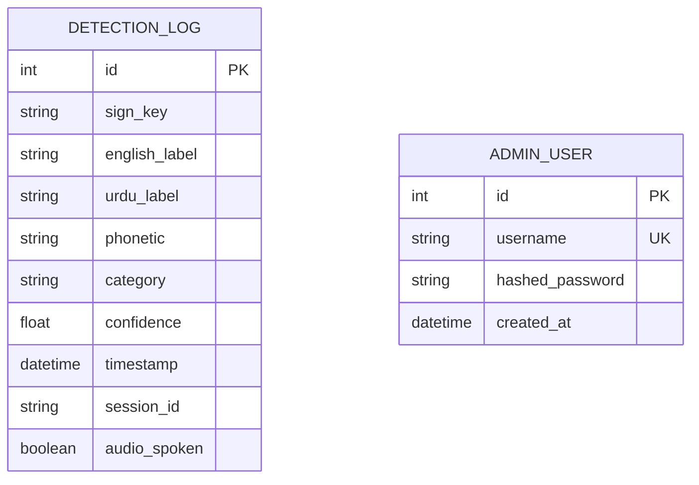

# Software Design Document (SDD)
## Project: Pakistani Sign Language (PSL) Real-Time AI Detection System
**Degree Program:** Final Year Project (FYP)  
**Version:** 1.0.0  
**Date:** October 2026  

---

### 1. Architectural Design

The system implements a client-edge hybrid pipeline:
- High-frequency video capture and coordinate extraction are performed locally in the user's browser using Google MediaPipe Hands compiled to WebAssembly.
- Only compact landmark coordinate vectors (63 floating point numbers per frame) are streamed across a lightweight WebSocket connection to the Python backend.
- The backend evaluates temporal sliding windows (30 frames) with a trained Bidirectional LSTM neural network, runs prediction smoothing, commits detection records to SQLite, and streams recognized signs back to the client.

```mermaid
graph TD
    subgraph Client ["Client Browser (React / Vanilla JS)"]
        A[HTML5 Video 640x480] --> B[MediaPipe Hands WebAssembly]
        B --> C[Extract 21 Landmarks x 3 Coords]
        C --> D[Canvas Mesh Renderer]
        C -->|JSON Payload [63 floats]| E[WebSocket Client]
        E -->|Prediction Object| F[UI Showcase Renderer]
        F --> G[SpeechSynthesis Engine]
    end

    subgraph Server ["FastAPI Backend Server"]
        E <==>|/ws/detect| H[WebSocket Handler]
        H --> I[Sliding Window Buffer (30 Frames)]
        I --> J[TensorFlow Bi-LSTM Neural Engine]
        J --> K[Prediction Smoother & Voter]
        K --> H
        K --> L[(SQLite Database)]
        M[Admin Analytics Router] --> L
    end
```

---

### 2. Component Specifications

#### 2.1 MediaPipe Landmark Extractor
- **File:** `backend/app/static/js/app.js`
- **Specification:** Extracts 21 topological keypoints of human hands:
  - Landmark 0: Wrist
  - Landmarks 1-4: Thumb (CMC, MCP, IP, Tip)
  - Landmarks 5-8: Index finger (MCP, PIP, DIP, Tip)
  - Landmarks 9-12: Middle finger (MCP, PIP, DIP, Tip)
  - Landmarks 13-16: Ring finger (MCP, PIP, DIP, Tip)
  - Landmarks 17-20: Pinky finger (MCP, PIP, DIP, Tip)
- Normalized range: `x ∈ [0, 1]`, `y ∈ [0, 1]`, `z` representing depth relative to wrist.

#### 2.2 Deep Learning Sequence Classifier
- **Model File:** `backend/app/ml/model.h5`
- **Architecture:**
  1. `Input Layer`: Shape `(30, 63)`
  2. `Bidirectional LSTM Layer 1`: 128 units, return sequences = True
  3. `BatchNormalization` & `Dropout(0.25)`
  4. `Bidirectional LSTM Layer 2`: 64 units
  5. `BatchNormalization` & `Dropout(0.25)`
  6. `Dense Layer 1`: 128 units, ReLU activation
  7. `BatchNormalization` & `Dropout(0.3)`
  8. `Dense Layer 2`: 64 units, ReLU activation
  9. `Softmax Output Layer`: 51 units corresponding to 51 PSL classes

#### 2.3 Prediction Smoothing & Temporal Voting
To eliminate prediction jitter caused by slight momentary sensor variations, `SignPredictor` maintains a FIFO circular buffer of recent frame predictions ($W=7$) and computes:
$$\hat{y} = \operatorname{mode}(\{y_{t-6}, \dots, y_t\})$$
Confidence is modulated by consistency across the window.

#### 2.4 Database Schema


---

### 3. REST & WebSocket API Specification

| Endpoint | Method / Protocol | Description | Payload / Response |
|----------|-------------------|-------------|--------------------|
| `/ws/detect` | WebSocket | Real-time landmark streaming & prediction | Send: `{"landmarks": [63 floats]}`<br>Receive: `{"status": "success", "urdu": "...", "confidence": 0.95}` |
| `/api/detection/signs` | GET | Returns all 51 supported PSL signs | `[{"id": "0", "english": "Alif", "urdu": "الف", ...}]` |
| `/api/detection/single` | POST | Static single inference test | Send: `{"landmarks": [...]}` |
| `/api/analytics/summary` | GET | Full KPI stats, 7-day trend & recent activity | `{"total_detections": 120, "avg_confidence": 0.94, ...}` |
| `/api/auth/login` | POST | Admin login authentication | `{"username": "admin", "password": "..."}` |
| `/health` | GET | Health & model status | `{"status": "healthy", "model_loaded": true}` |
