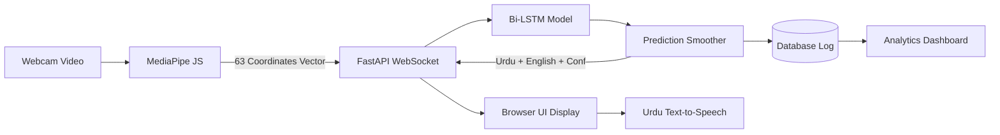

# Software Requirements Specification (SRS)
## Project: Pakistani Sign Language (PSL) Real-Time AI Detection System
**Degree Program:** Final Year Project (FYP) — Computer Science / Software Engineering  
**Version:** 1.0.0  
**Date:** October 2026  

---

### 1. Introduction

#### 1.1 Purpose
The purpose of this document is to specify the complete functional and non-functional requirements for the **Pakistani Sign Language (PSL) Real-Time AI Detection System**. This system bridges the communication gap between the deaf/mute community and the general public in Pakistan by translating sign language gestures into Urdu text and synthesized voice output in real-time.

#### 1.2 Scope
The system encompasses:
- Real-time hand landmark extraction via webcam using Google MediaPipe (21 3D coordinates per hand).
- Temporal gesture sequence classification utilizing a Bidirectional Long Short-Term Memory (Bi-LSTM) deep learning model.
- 51 PSL classes: 36 Urdu alphabet letters (حروفِ تہجی), 10 numerical digits (اعداد), and 5 core conversational phrases.
- Low-latency bi-directional streaming over WebSockets.
- Urdu Text-to-Speech (TTS) audio synthesis.
- An interactive Administrator & Analytics Dashboard for tracking system usage, prediction accuracy, and popular sign metrics.

#### 1.3 Target Audience
- Deaf and hard-of-hearing individuals communicating in everyday scenarios.
- General hearing public, educational institutions, special education schools, and customer service counters.
- Academic examiners and FYP evaluation committees.

---

### 2. Overall Description

#### 2.1 Product Perspective
The system operates as an end-to-end client-server architecture:
- **Client (Frontend):** Modern web interface (HTML5, Vanilla CSS, JS) running client-side MediaPipe Hands in WebAssembly/WebGL to eliminate server video streaming overhead.
- **Server (Backend):** High-performance Python FastAPI service maintaining asynchronous WebSocket sessions and executing tensor inference on sliding landmark sequence windows.
- **Database:** SQLite / PostgreSQL engine storing translation event logs, model confidence logs, and session statistics.

---

### 3. Functional Requirements

#### FR-01: Hand Landmark Tracking
- The system must capture video stream from standard webcams (minimum 640x480 resolution at 24+ fps).
- The system must extract 21 3D hand keypoints (x, y, z normalized) totaling 63 values per frame.
- The system must visually render the hand skeletal mesh overlay onto the canvas feed.

#### FR-02: Real-Time Sign Classification
- The ML inference engine must process sliding temporal buffers of 30 frames (~1.0 second of motion).
- The model must output classification probability distributions over 51 PSL classes.
- The system must apply moving-window majority voting to eliminate prediction flicker.

#### FR-03: Multilingual Translation Output
- The system must display recognized signs in:
  1. Urdu Nastaliq calligraphy script.
  2. English transliteration.
  3. Phonetic pronunciation cue.
- The system must maintain a running sentence construction bar allowing consecutive signs to be concatenated into sentences with a single-click copy function.

#### FR-04: Audio Speech Synthesis (TTS)
- The system must synthesize audible spoken pronunciation of recognized signs.
- The system must include audio mute/unmute toggling.
- The system must enforce a 2.5-second anti-spam repetition cooldown.

#### FR-05: Administrative Analytics & Monitoring
- The dashboard must display total translations, 24-hour volume, and mean confidence score.
- The dashboard must plot 7-day translation activity trends.
- The dashboard must break down detections by category (Letters, Digits, Phrases).
- The dashboard must rank top-performing signs and stream live detection event logs.

#### FR-06: Vocabulary Directory & Simulation
- The system must provide a searchable PSL reference catalog of all 51 signs.
- Users must be able to audition pronunciation and simulate detection tests without requiring camera hardware.

---

### 4. Non-Functional Requirements

- **Latency:** Total round-trip latency (frame capture -> landmark extraction -> model prediction -> UI render) must be less than 200 ms.
- **Inference Accuracy:** Target test set classification accuracy ≥ 90% with confidence threshold gating (> 0.75).
- **Usability:** Accessible dark-mode glassmorphic user interface compliant with WCAG accessibility standards.
- **Portability:** Cross-platform web architecture executable on standard browsers (Chrome, Edge, Firefox) without specialized client plugins.
